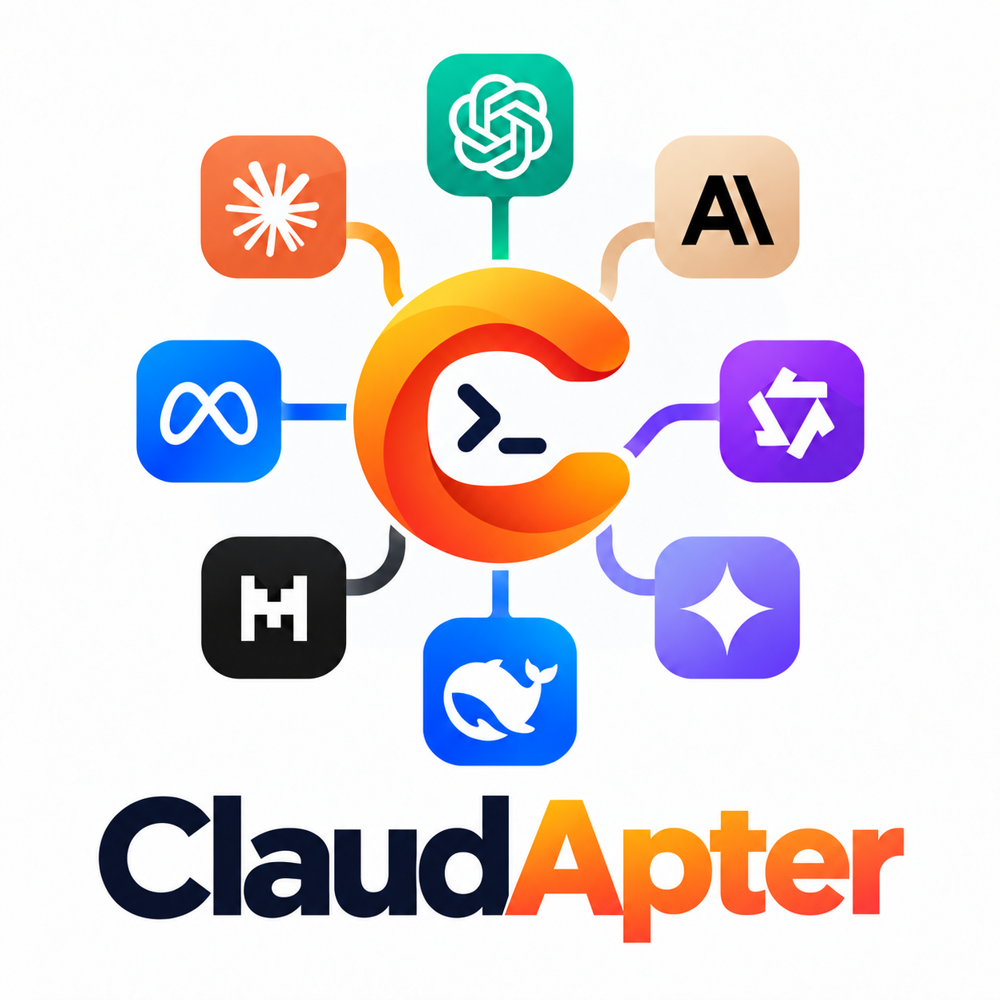
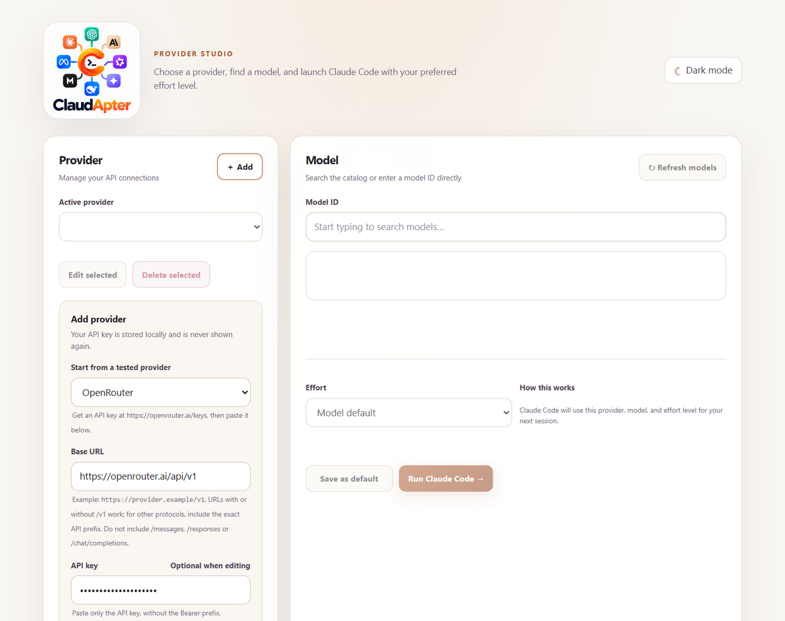
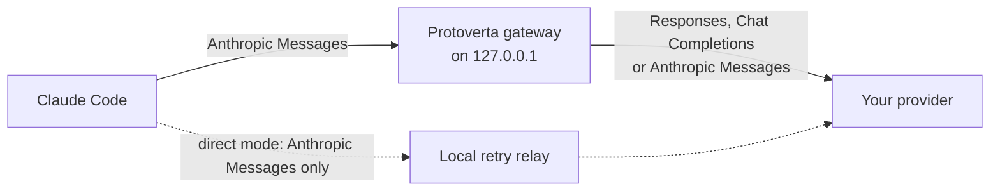

<div align="center">
  <picture>
    <source media="(prefers-color-scheme: dark)" srcset="assets/ClaudApter_black.png">
    
  </picture>
  <p><strong>A clean, focused way to connect Claude Code to the model provider you choose.</strong></p>
  <p>Manage providers, find models, choose an effort level, and launch Claude Code from one local setup studio.</p>
  <p>
    <a href="LICENSE"></a>
    
    
    <a href="https://github.com/HaianCao/ClaudApter/actions/workflows/ci.yml"></a>
    <a href="https://github.com/HaianCao/Protoverta"></a>
  </p>
  <p><a href="#quick-start">Quick start</a> &middot; <a href="#configure-a-provider">Providers</a> &middot; <a href="#use-claudapter">CLI</a> &middot; <a href="#privacy-and-security">Security</a></p>
</div>

---

ClaudApter is a lightweight launcher and configuration studio for the official Claude Code CLI. It lets you connect compatible API gateways, choose a model and effort level, and start Claude Code with those settings without replacing or modifying Claude Code itself.

## What you can do

- Save and switch between multiple providers in a local browser-based setup page.
- Search a provider's model catalog as you type, or enter a model ID manually.
- Choose a default provider, model, and effort level for future sessions.
- Add, edit, and remove provider connections, and switch between light and dark themes.
- Launch Claude Code in the current terminal, or select a different provider/model for one run.
- Keep API keys local and separate from the provider configuration file.

Connect native Anthropic Messages providers directly, or translate Chat Completions and Responses providers through the optional local [Protoverta](https://github.com/HaianCao/Protoverta) gateway. Model discovery is optional; you can enter model IDs yourself when a provider does not offer it. A catalog entry does not guarantee Claude Code compatibility; [Anthropic does not support routing Claude Code to non-Claude models through third-party gateways](https://code.claude.com/docs/en/llm-gateway).

## Quick start

### Windows

In PowerShell, run the installer directly from GitHub. No repository clone is needed:

```powershell
& ([scriptblock]::Create((irm "https://raw.githubusercontent.com/HaianCao/ClaudApter/main/scripts/install.ps1")))
```

The installer sets up ClaudApter and its local Protoverta gateway for your Windows account, and installs the official Claude Code CLI if it is missing. It does not require administrator access. Run the same command again to update; your providers and API keys are kept.

Open a new terminal and run:

```powershell
claude-ca
```

The first time, this opens the setup page in your browser (later, `claude-ca setup` opens it). Paste your provider's base URL and API key, choose the API it speaks, pick a model and select **Run Claude Code**. That is all: authentication, the connection mode, the model's context and output limits and retries are set up automatically.

Windows supports native CLI executables and standard npm global or project installations. Custom batch-wrapper behavior is not supported; use an official CLI installation if the launcher cannot resolve it safely.

## Configure a provider

<p align="center"></p>

In the setup page:

1. Select **Add**. For **OpenRouter**, **NVIDIA NIM**, **TokenHarbor** or **AgentRouter**, pick it under *Start from a tested provider*; otherwise leave *Custom provider*.
2. Paste the **Base URL** (for example `https://gateway.example.com/v1`, without `/messages` or `/chat/completions`) and your **API key** (without a `Bearer ` prefix).
3. Choose the **API** your provider speaks: Anthropic Messages, Chat Completions or Responses.
4. Select **Save provider**. Setup checks the key without generating anything (no cost), uses `Authorization: Bearer` or, if the provider needs it, `x-api-key`, and tells you if the key is rejected or the address has no such API.
5. Pick a model from the list (or type its ID), choose an effort level, then **Save as default** or **Run Claude Code**.

The provider's name and ID come from its address; change them, the authentication or the connection mode under **Advanced: connection details** if you need to.

### How ClaudApter connects



| | Local gateway (default) | Direct |
|---|---|---|
| Path | Claude Code → Protoverta on your computer → provider | Claude Code → provider |
| Provider APIs | Anthropic Messages, Chat Completions, Responses (translated) | Anthropic Messages only |
| Extras | Retries by error class, stream checks, keep-alives, clear errors | Retries by a small local relay |
| When to choose | Almost always | Providers that only accept the official Claude Code client (AgentRouter); set automatically |

Your key stays on your computer in both cases. Switch under **Advanced: connection details**, or set `execution_mode = "direct"` or `"gateway"` for the provider in the configuration file. Providers saved by ClaudApter 0.1 keep the mode they had.

When you choose **Run Claude Code**, the setup page stops and Claude Code takes over the terminal where you launched `claude-ca setup`. Direct mode passes the provider key through the child environment; gateway mode keeps it in the local gateway and gives Claude Code a temporary local credential.

**Run Claude Code** uses the current selection for this session. Choose **Save as default** explicitly to change wrapper defaults. On Claude Code 2.1.308 or newer 2.1.x gateway sessions (verified on 2.1.308, 2.1.318 and 2.1.319), `/model` lists the selected main and configured auxiliary models without renaming their IDs. Press **s** in the native picker to apply a model only to this session; **Enter** or `/model MODEL_ID` follows Claude Code's explicit save-default behavior. Discovery is not capability certification, and manual model IDs remain available.

### Gateway details

Reasoning compatibility is automatic for new providers. Native Messages keeps
the provider's reasoning behavior. On translated Chat/Responses connections the
model keeps its default reasoning and the gateway explicitly omits reasoning
output that Claude Code's Messages protocol cannot represent (it is never shown
as answer text, given a fake signature or sent elsewhere). Many current models
reason on every turn and reject or ignore a "reasoning off" request, so this is
what keeps them usable. Choose a manual **disabled** policy under **Advanced:
reasoning settings** to request less reasoning compute where a model honours it.

The launcher sets `CLAUDE_CODE_DISABLE_REFUSAL_FALLBACK=1` for the session
(unless you set it), so Claude Code does not switch a flagged request to a
built-in Claude model the provider does not serve. **Auto mode** was checked live on
Claude Code 2.1.319 through the gateway and runs tool calls; see the provider
notes in Protoverta's `docs/compatibility/providers.md`. **Model limits**
(`CLAUDE_CODE_MAX_CONTEXT_TOKENS`, `CLAUDE_CODE_MAX_OUTPUT_TOKENS`) are set
automatically from the selected model's maximums when the provider reports them
in its model list (OpenRouter and TokenHarbor do; NVIDIA NIM does not). The
output limit is capped at half the context window so long conversations keep
room for input. Values you enter under **Model limits** on a provider always
win; leave them empty to use the reported maximums.

How the gateway converts each protocol, its options and limits: [Protoverta documentation](https://haiancao.github.io/Protoverta/). Tested providers (OpenRouter, NVIDIA NIM, TokenHarbor, AgentRouter), their known limits and recommended settings: [provider compatibility](https://github.com/HaianCao/Protoverta/blob/main/docs/compatibility/providers.md).

ClaudApter **0.2.0** installs [Protoverta](https://github.com/HaianCao/Protoverta) **0.3.0**; the installer verifies the gateway wheel's SHA-256 before installing it. Native Messages preserves beta headers and thinking/signature payloads. Chat and Responses translation supports text, URL/base64 user image inputs and client-side function tools, including streaming and multiple tool calls. Rich image tool results map Messages ↔ Responses; Chat routes and provider-owned file IDs remain unsupported. Public reasoning from Chat/Responses is not converted into fabricated Messages thinking/signatures.

Under **Advanced: model compatibility checks**, you can select a local capability
registry file and require verified capabilities. Relative paths start at the
configuration folder. Unsupported features are blocked before API calls; the
strict option also blocks missing records. Leave this optional section empty
unless you maintain capability records for your provider's exact API prefix and
model IDs. For Messages, registry entries use the actual API prefix including
`/v1`, whether setup was given the root URL or a URL already ending in `/v1`. Basic launch capabilities are
checked before setup closes; tools and output formats are checked against each
actual request.

Translated sessions disable thinking and unsupported experimental capabilities in the child process only. Cache hints and telemetry are omitted, and tool errors become labelled text. Initial token usage is provisional and corrected at completion using real upstream counts. Effort supports default/low/medium/high; hidden reasoning replay, audio/video, hosted tools and compaction are not supported. Use a compatible native Messages provider when you need features outside the translated subset. Existing sessions containing unsupported blocks cannot be resumed through translation.

## Use ClaudApter

```powershell
claude-ca                                      # launch using saved defaults
claude-ca setup                                # open the provider setup page
claude-ca run -p PROVIDER -m MODEL_ID          # choose a provider and model for this run
claude-ca print -p PROVIDER -m MODEL_ID -- "Explain this repository"
claude-ca resume -p PROVIDER -m MODEL_ID -- SESSION_ID
claude-ca continue -p PROVIDER -m MODEL_ID
claude-ca providers
claude-ca models -p PROVIDER
claude-ca doctor -p PROVIDER -m MODEL_ID
claude-ca validate
claude-ca --help
```

After installation, `claude-ca` is available from any working directory. Re-run the installer command to update ClaudApter; your provider settings and API keys are retained. Updates are checked before activation, so a failed download or package preparation leaves the existing version usable.

## Automatic retry

When a provider fails a request with a temporary error, ClaudApter waits and sends the same request again, so you see an error only when it keeps failing. In gateway mode Protoverta does this; in direct mode a small local relay does. A request is retried at one layer only.

| Retried (default) | Not retried (shown at once) |
|---|---|
| rate limits, overloaded or unavailable providers, server errors, network failures, streams that fail before any output, backend mismatches (for example "created under a different Azure OpenAI resource"), unrecognised errors | rejected key, no credit, unknown model, context too long, content policy, invalid request |

Output that already reached Claude Code is never sent again. Defaults: up to 10 retries about 60 s apart (± 20 %, at least the provider's `Retry-After`), 30 minutes at most. Press Esc in Claude Code to cancel; the wait stops too. Each decision, with the provider's error message, is written to `%LOCALAPPDATA%\claudapter\retry.log` (kept under about 1 MB).

To change this, add a `[retry]` table to `%APPDATA%\claudapter\config.toml` (every key is optional):

```toml
[retry]
enabled = true             # false: no retries
max_retries = 10           # 0-100
delay_seconds = 60         # 0-3600
jitter = 0.2               # fraction of the delay
max_total_seconds = 1800   # stop waiting after this long
retry_classes = []         # add classes, e.g. ["model_not_found"]
no_retry_classes = []      # remove classes, e.g. ["network"]
```

Classes: `rate_limit`, `overloaded`, `server`, `network`, `stream_interrupted`, `backend_mismatch`, `unknown` (retried by default) and `auth`, `billing`, `model_not_found`, `context_length`, `content_policy`, `invalid_request`. Network retries resend a request whose generation may already have started, which some providers bill; remove `network` if that matters to you.

## Troubleshooting

| What you see | What to do |
|---|---|
| "The provider rejected this API key" when saving | Paste the key again (without `Bearer `); check that it is active and has credit. |
| "This provider only accepts its official CLIs" | Expected for AgentRouter: it runs Direct and has no readable model list; type the model ID. |
| "No model list" / the model list is empty | Type the exact model ID from the provider's website. |
| "This provider has no … endpoint at this address" | Check the base URL (it usually ends in `/v1`) and the API you chose. |
| Requests fail after a long wait | Open `%LOCALAPPDATA%\claudapter\retry.log` to see the provider's error for each attempt. |
| "Protoverta component is missing or broken" | Run the installer command again; it repairs the installation and keeps your settings. |
| Behind a company proxy | Set `HTTPS_PROXY` (and `NO_PROXY` for local addresses); the local gateway is reached directly. |
| A provider needs custom headers or query parameters (for example Azure `api-version`) | Not supported yet; use an OpenAI- or Anthropic-compatible endpoint for that provider. |

## Uninstall

In PowerShell, run the uninstaller directly from GitHub:

```powershell
& ([scriptblock]::Create((irm "https://raw.githubusercontent.com/HaianCao/ClaudApter/main/scripts/uninstall.ps1")))
```

It removes the launcher and its wrapper PATH entries, not the official Claude Code CLI. Separate prompts let you reset adapter environment overrides and delete default provider settings, API keys and cache (type `DELETE`). Everything is kept unless you confirm its removal.

Environment reset clears only `CLAUDE_CA_CONFIG`, `CLAUDE_CA_CACHE` and `CLAUDE_CA_ENV_FILE` at user/process scope. It does not delete custom-path files, provider key variables, or shared `ANTHROPIC_*`/`OPENAI_*` variables. Machine-wide settings are not changed. Open a new terminal afterward. To explicitly request reset without prompts, append `-ResetEnvironment -NonInteractive`; data deletion still requires interactive confirmation.

## Advanced gateway settings

Optional advanced gateway policies support evidence-scoped provider profile
files, shared quota databases and bounded HTTP-rejection retries. Leave them
blank for existing behavior. They require the pinned Protoverta
release, which the gateway preview installs. Use the same absolute database
path in both launchers to coordinate the same upstream prefix/credential.
These policies do not change direct mode or enable model fallback.

## Privacy and security

Provider settings and API keys are stored on your computer. API keys are kept in a local `.env` file in plain text, so protect the file and never commit or share it. A key saved there takes precedence over an environment variable of the same name; the environment variable is used only when the file has no value. Provider credentials are kept separate from Claude Code's own authentication. The setup page listens only on your own computer (`127.0.0.1`) and uses a per-session access token. Gateway mode (the default) starts a temporary Protoverta server on `127.0.0.1` and stops it when Claude Code exits; direct mode starts a small retry relay there instead. Neither adds credentials or stores conversation content; `retry.log` keeps only request paths and provider error messages.

Client interoperability is tested with scripted local upstreams and live checks of the tested providers; other providers and models can differ. Gateway mode passes a temporary local credential to Claude Code and keeps the provider key in the launcher.

ClaudApter does not edit Claude Code's own settings or session transcripts. The `doctor` command sends a small real `/v1/messages` request and may incur an API charge; it does not verify streaming or tool calls. Resuming with a different provider/model can be attempted, but equivalent reasoning state or tool behavior is not guaranteed.

If Claude Code's `/status` shows a different gateway or credential from the one selected in ClaudApter, check for conflicting `ANTHROPIC_BASE_URL`, `ANTHROPIC_AUTH_TOKEN`, or `ANTHROPIC_API_KEY` values in Claude Code's [settings files](https://code.claude.com/docs/en/llm-gateway-connect). Claude Code gives settings-file environment values precedence over a launcher process's environment; ClaudApter does not overwrite those settings. In API-key mode, Claude Code may also ask you to approve the key once.

## Session tools

The integration preview has a local-fixture check for one foreground subagent
using the selected provider/model on Claude Code **2.1.308**, **2.1.318** and **2.1.319**, through native
Messages or translated Chat/Responses. It verifies a separate child request,
a successful read-only tool result and completion reported by the harness.
Choose the **selected** agent-model policy to keep the same-model default.
The **custom** policy can select an exact child model on that same provider.
Local fixtures verify model B tool use and continuation through `SendMessage`
while the parent keeps model A. Known capability/effort/budget limits are checked
against each requested model; missing evidence follows the configured verification policy.
This is harness interoperability evidence, not a guarantee for every provider.
Detached execution and closed/persisted child resume need separate checks;
custom agent definitions and explicit overrides retain Claude Code precedence.

External stdio MCP servers can be selected for one launch with
`CLAUDE_CA_MCP_CONFIG`: a JSON file with `mcpServers`, each containing an absolute
executable `command`, optional `args`, and `env_vars` names. Claude loads only
these servers for that launch. Keys stay in environment variables; the temporary
Claude configuration contains variable references and is cleaned up on exit.

## For contributors

```powershell
python -m pip install -e ".[test]"
python -m pytest
```

To test an unpublished Protoverta build, pass `-ProtovertaWheel PATH_TO_WHEEL` to the local installer; it is installed instead of the pinned, hash-verified release wheel.

Installer smoke tests can pass `-NoPathChanges` to install and uninstall scripts. Redirect `APPDATA` and `LOCALAPPDATA` in a disposable child shell as well: the flag alone does not isolate installation or user data paths.

## Gateway checks and diagnostics

Gateway previews provide route checks through `claude-ca doctor -p PROVIDER -m MODEL --allow-live --check text --check streaming --report NEW_REPORT.json`.
These checks may incur provider charges; without `--allow-live`, gateway doctor makes no provider requests.
Advanced setup can enable local session diagnostics, counting policies and evidence freshness checks. Diagnostics omit prompts and keys; reopen setup to view the last session report.

## License

ClaudApter is licensed under the [MIT License](LICENSE).
