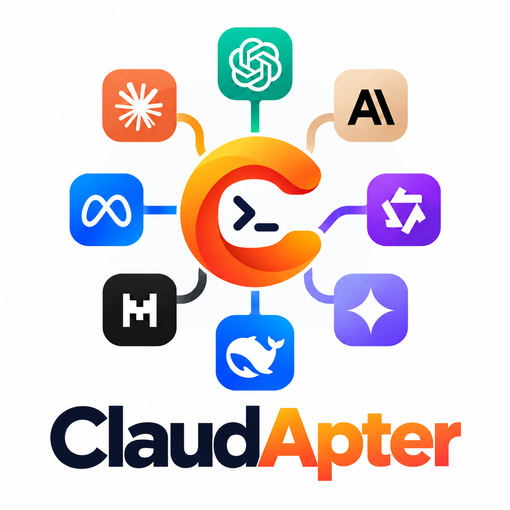

<div align="center">
  <picture>
    <source media="(prefers-color-scheme: dark)" srcset="assets/ClaudApter_black.png">
    
  </picture>
  <p><strong>A clean, focused way to connect Claude Code to the model provider you choose.</strong></p>
  <p>Manage providers, find models, choose an effort level, and launch Claude Code from one local setup studio.</p>
  <p>
    <a href="LICENSE"></a>
    
    
    
  </p>
  <p><a href="#quick-start">Quick start</a> &middot; <a href="#configure-a-provider">Providers</a> &middot; <a href="#use-claudapter">CLI</a> &middot; <a href="#privacy-and-security">Security</a></p>
</div>

---

ClaudApter is a lightweight launcher and configuration studio for the official Claude Code CLI. It lets you connect compatible API gateways, choose a model and effort level, and start Claude Code with those settings without replacing or modifying Claude Code itself.

## What you can do

- Save and switch between multiple providers in a local browser-based setup page.
- Search a provider's model catalog as you type, or enter a model ID manually.
- Choose a default provider, model, and effort level for future sessions.
- Add, edit, and remove provider connections, and switch between light and dark themes.
- Launch Claude Code in the current terminal, or select a different provider/model for one run.
- Keep API keys local and separate from the provider configuration file.

Connect native Anthropic Messages providers directly, or translate Chat Completions and Responses providers through the optional local Protoverta gateway. Model discovery is optional; you can enter model IDs yourself when a provider does not offer it. A catalog entry does not guarantee Claude Code compatibility; [Anthropic does not support routing Claude Code to non-Claude models through third-party gateways](https://code.claude.com/docs/en/llm-gateway).

## Quick start

### Windows

In PowerShell, run the installer directly from GitHub. No repository clone is needed:

```powershell
& ([scriptblock]::Create((irm "https://raw.githubusercontent.com/HaianCao/ClaudApter/main/scripts/install.ps1")))
```

The installer sets up ClaudApter for your Windows account and can install the official Claude Code CLI if it is missing. It does not require administrator access. When installation finishes, open a new terminal and start setup:

```powershell
claude-ca setup
```

The setup page opens in your browser. Add a provider, enter its API key, refresh the model list or type a model ID, then choose your default model and effort level. Setup is opened only when you run `claude-ca setup`.

## Configure a provider

In the setup page:

1. Select **Add**, enter a provider ID and display name, and choose the upstream protocol. For Messages, `https://gateway.example.com` leads to `/v1/messages`. For Chat or Responses, enter the exact API prefix, such as `https://gateway.example.com/v1` or `/api/v4`, without the endpoint suffix; gateway mode is required.
2. Choose **Bearer token** for `Authorization: Bearer ...` or **API key** for `x-api-key`, then enter your key.
3. Select **Refresh models** to query the provider's model catalog, or type a model ID directly.
4. Choose an effort level and select **Save as default** or **Run Claude Code**.

When you choose **Run Claude Code**, the setup page stops and Claude Code takes over the terminal where you launched `claude-ca setup`. Direct mode passes the provider key through the child environment; gateway mode keeps it in the local gateway and gives Claude Code a temporary local credential.

### Optional local gateway

In the provider editor, **Upstream reasoning** defaults to the provider/client
settings. Choose **Disabled — OpenRouter** for OpenRouter models whose default
reasoning cannot be translated, or **Disabled — standard API** for compatible
upstreams. Disabling requires gateway mode and overrides effort; models requiring
reasoning may reject it. Unsupported reasoning output is never silently hidden.

Add `-WithGateway` to the installer command to include the pinned Protoverta component, then select **Local Protoverta gateway** as the connection mode. Native Messages preserves beta headers and thinking/signature payloads. Chat and Responses translation supports text and client-side function tools, including streaming and multiple tool calls.

The gateway preview is on `integration/protoverta`, not stable `main`:

```powershell
& ([scriptblock]::Create((irm "https://raw.githubusercontent.com/HaianCao/ClaudApter/integration/protoverta/scripts/install.ps1"))) -WithGateway -SourceBranch integration/protoverta
```

Translated sessions disable thinking and unsupported experimental capabilities in the child process only. Cache hints and telemetry are omitted, and tool errors become labelled text. Initial token usage is provisional and corrected at completion using real upstream counts. Effort supports default/low/medium/high; hidden reasoning replay, multimodal content, hosted tools and compaction are not supported. Use native Messages for those features. Existing sessions containing unsupported blocks cannot be resumed through translation.

## Use ClaudApter

```powershell
claude-ca                                      # launch using saved defaults
claude-ca setup                                # open the provider setup page
claude-ca run -p PROVIDER -m MODEL_ID          # choose a provider and model for this run
claude-ca print -p PROVIDER -m MODEL_ID -- "Explain this repository"
claude-ca resume -p PROVIDER -m MODEL_ID -- SESSION_ID
claude-ca continue -p PROVIDER -m MODEL_ID
claude-ca providers
claude-ca models -p PROVIDER
claude-ca doctor -p PROVIDER -m MODEL_ID
claude-ca validate
claude-ca --help
```

After installation, `claude-ca` is available from any working directory. Re-run the installer command to update ClaudApter; your provider settings and API keys are retained.

## Uninstall

In PowerShell, run the uninstaller directly from GitHub:

```powershell
& ([scriptblock]::Create((irm "https://raw.githubusercontent.com/HaianCao/ClaudApter/main/scripts/uninstall.ps1")))
```

It removes the ClaudApter launcher and its PATH entry while keeping provider settings and API keys. The official Claude Code CLI is not removed. To also remove ClaudApter's data, append `-DeleteData` to the command above and confirm the separate deletion prompt.

## Privacy and security

Provider settings and API keys are stored on your computer. API keys are kept in a local `.env` file in plain text, so protect the file and never commit or share it. The setup page listens only on your own computer (`127.0.0.1`) and uses a per-session access token. Direct mode does not proxy conversations; optional gateway mode starts a temporary loopback Protoverta server and stops it when Claude Code exits.

Gateway mode is experimental. Client interoperability is tested with scripted local upstreams; each real provider/model still needs its own compatibility check. Gateway mode passes a temporary local credential to Claude Code and keeps the provider key in the launcher.

ClaudApter does not edit Claude Code's own settings or session transcripts. The `doctor` command sends a small real `/v1/messages` request and may incur an API charge; it does not verify streaming or tool calls. Resuming with a different provider/model can be attempted, but equivalent reasoning state or tool behavior is not guaranteed.

If Claude Code's `/status` shows a different gateway or credential from the one selected in ClaudApter, check for conflicting `ANTHROPIC_BASE_URL`, `ANTHROPIC_AUTH_TOKEN`, or `ANTHROPIC_API_KEY` values in Claude Code's [settings files](https://code.claude.com/docs/en/llm-gateway-connect). Claude Code gives settings-file environment values precedence over a launcher process's environment; ClaudApter does not overwrite those settings. In API-key mode, Claude Code may also ask you to approve the key once.

## For contributors

```powershell
python -m pip install -e ".[test]"
python -m pytest
```

To test an unpublished gateway build, pass `-ProtovertaWheel PATH_TO_WHEEL` to the local installer. This enables the gateway extra and checks its pinned package version without copying Protoverta source into this project.

Installer smoke tests can pass `-NoPathChanges` to install and uninstall scripts. Redirect `APPDATA` and `LOCALAPPDATA` in a disposable child shell as well: the flag alone does not isolate installation or user data paths.

## License

ClaudApter is licensed under the [MIT License](LICENSE).
